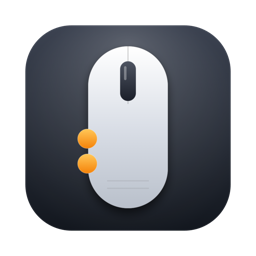
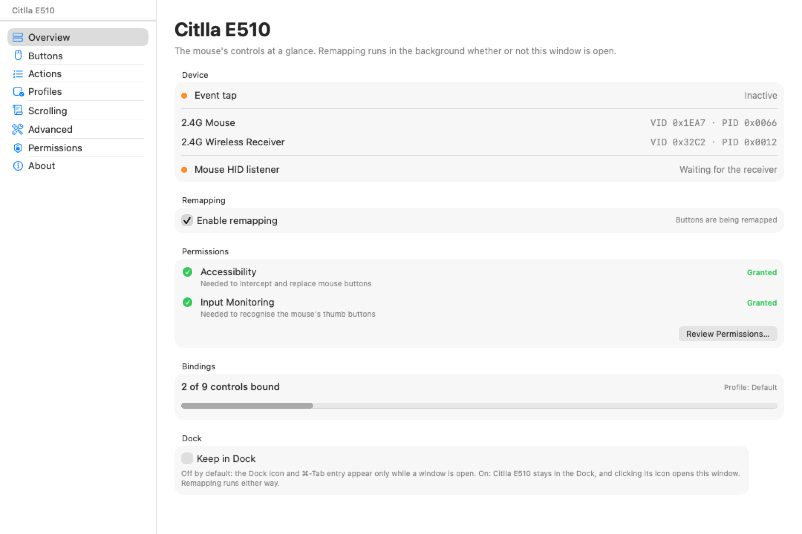
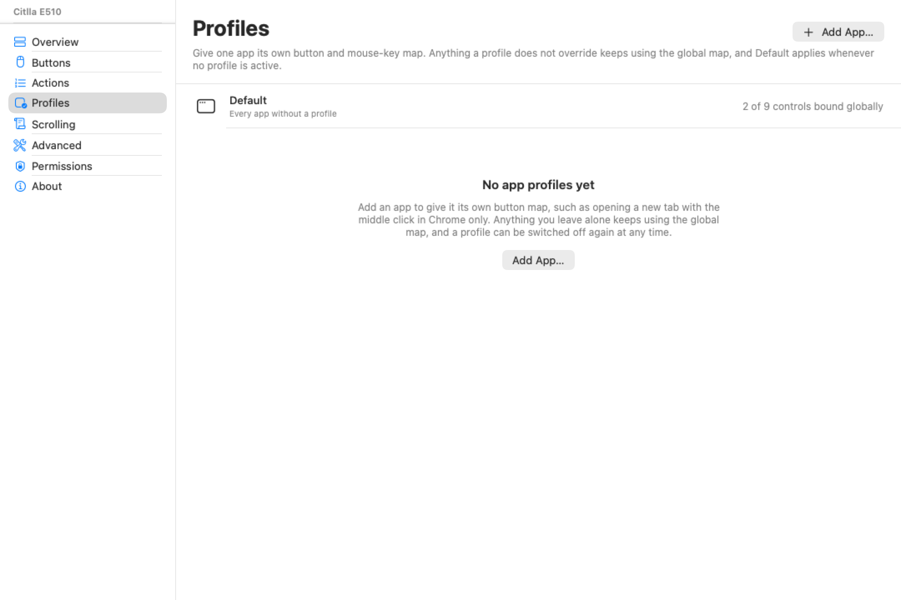
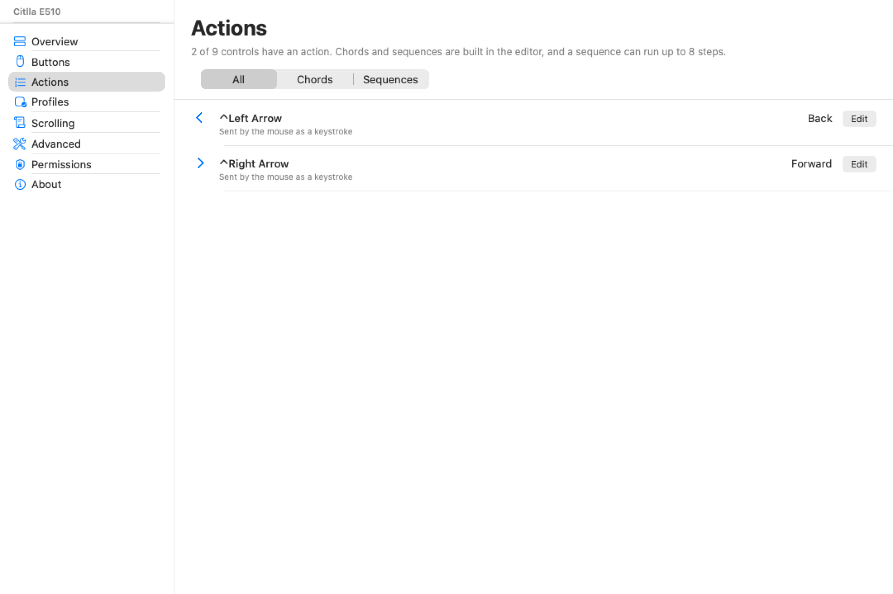
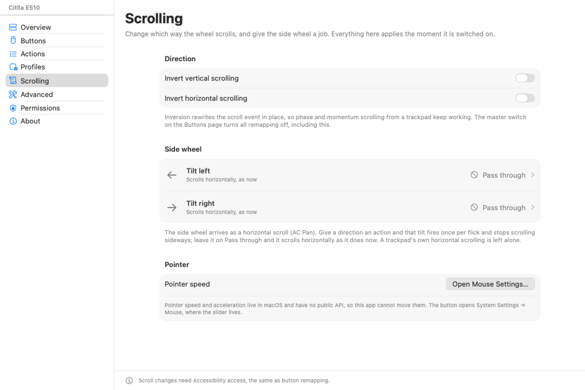
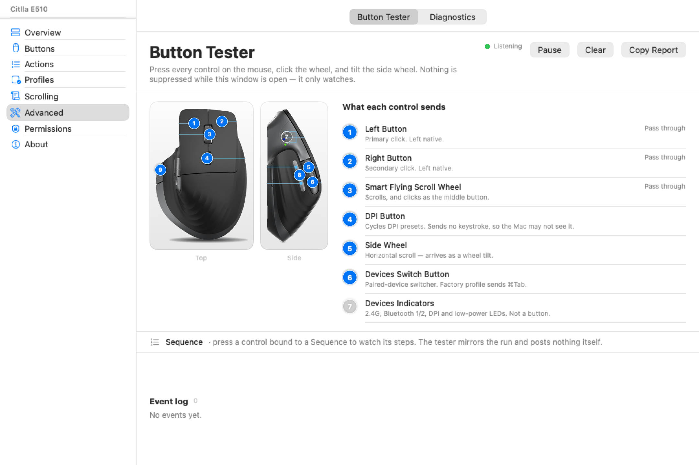

# Citlla E510

A small macOS menu bar app that makes the extra buttons on a **CITLLA PRO MAX
E510** wireless mouse actually useful on a Mac. The mouse keeps working out of
the box, and a real window covers the rest: which control runs which action,
chained actions, per-app profiles and scroll direction.

macOS does not ship a way to remap the side buttons, thumb buttons, or other
extra buttons on third-party mice. Citlla E510 installs a session event tap,
lets you choose an action for each physical button, and replaces the original
button event with that action — one action or a short sequence, for every app or
for one app only.



## Screenshots

**Overview** — the app's state at a glance: the event tap, the supported
receivers, the HID listener, the remapping switch, permission health, how many
controls are bound and which profile is active, and the Dock preference:



**Profiles** — the global map as the always-visible Default row, plus one row
per app that overrides it. This is the section before any app has been added:



**Actions** — every control that has an action, in one list, with filters for
chords and sequences so a chained action is visible without opening each
control:



**Scrolling** — invert either scroll axis, give the side wheel an action per
direction, and the honest pointer-speed link:



**Advanced** — the button tester and diagnostics as two panes of the main
window. The tester shows what each control sends and counts the steps of a
sequence as it runs:



The rest of the window: [Buttons](docs/snapshots/main-buttons.png) ·
[Permissions](docs/snapshots/main-permissions.png) ·
[About](docs/snapshots/main-about.png)

## Window and Dock

Citlla E510 is still a menu bar app: `LSUIElement` is `YES`, it starts in
`.accessory` mode, and there is no Dock icon until you open the window. Opening
the main window switches the app to `.regular`, so it gets a Dock icon, a ⌘-Tab
entry and a real app menu for as long as a window is open. Closing the last
window puts it back to `.accessory`; remapping never stops.

**Keep in Dock** on the Overview section keeps the app in `.regular` all the
time and makes the Dock icon open the main window, which is the Logi Options+
shape. The menu bar icon is unchanged and still has **Enable Remapping**,
**Open Citlla E510…**, **Test Buttons…**, **Diagnostics…**, **Launch at Login**
and **Quit Citlla E510**.

## Defaults

The CITLLA PRO MAX E510 does not report its extra buttons as ordinary mouse
buttons. Its receiver also presents a keyboard interface, and the two thumb
buttons send `⌃←` and `⌃→` as real keystrokes; the ninth control sends `⌃⌘F`.
Citlla E510 watches the mouse's own HID reports so it can tell those keystrokes
apart from the same shortcuts on your keyboard. Out of the box:

| Control | Default |
| --- | --- |
| Left, right and wheel click | Pass through |
| Rear thumb button (sends `⌃←`) | Back (`⌘[`) |
| Front thumb button (sends `⌃→`) | Forward (`⌘]`) |
| Ninth control (sends `⌃⌘F`) | Pass through (keeps the factory full-screen toggle) |

The mouse reports only buttons 1–3; the diagram's other controls send
keystrokes or stay in firmware, so there are no rows for buttons 4–8.

You can bind a control to:

- macOS actions: Mission Control, App Exposé, Show Desktop, Launchpad,
  Spotlight, Screenshot, Lock Screen, Sleep Display, media keys, volume, and
  back/forward
- Any keyboard shortcut (press Record, then press the keys)
- A mouse click (left, right, middle), optionally with ⌃⌥⇧⌘ held as a chord
- A sequence of up to 8 of the above, run back to back
- Open an app, open a URL, or run a shell command

Two of those actions cannot be driven from a button. **Spotlight** (`⌘Space`)
and **Lock Screen** (`⌃⌘Q`) are symbolic hotkeys: macOS only honours them for
a real key press and ignores anything an app synthesises, so a remapped button
cannot fire them. The action picker marks them "(not available)" and explains
the workaround (use the keyboard, or pick another action). Mission Control, App
Exposé, Show Desktop and Launchpad work because they are driven through the
Dock, and the media keys work because they are ordinary key events.

Open the **Buttons** section to see the mouse's nine controls laid out as they
are on the CITLLA diagram — each number is drawn on the render at the control it
labels — click a row to change its binding, and **Test Buttons…** in the menu
bar to see what each physical control actually sends. The **Buttons** pane
inside that section lists the same controls in two groups: the keys the mouse
sends (`⌃←`, `⌃→`, `⌃⌘F`) and the three mouse buttons it reports.

## The mouse, as the manufacturer numbers it

The **Mouse** pane of the **Buttons** section shows the two renders from the
CITLLA box diagram next to the nine numbered callouts, with the diagram's own
titles. Each row is also the place to change that control's binding.

| # | Control | Diagram says | On the Mac |
| --- | --- | --- | --- |
| 1 | Left Button | primary click | native |
| 2 | Right Button | secondary click | native |
| 3 | Smart Flying Scroll Wheel | scroll + middle click | scroll, button 3 |
| 4 | DPI Button | DPI presets | firmware only |
| 5 | Side Wheel | horizontal scroll | wheel tilt, not a button |
| 6 | Devices Switch Button | switch paired device | sends `⌘Tab` in the factory profile |
| 7 | Devices Indicators | 2.4G / BT1 / BT2 / DPI / low power LEDs | not a button |
| 8 | Forward / Back Buttons | the two thumb buttons | sends `⌃←` and `⌃→` |
| 9 | Return to Desktop / Full Screen | bottom-right thumb button | sends `⌃⌘F` (confirmed); remappable like the rest |

## Chained actions

Two compound kinds sit on top of the plain actions, and both are edited with
the same controls as a single action.

**Chords** hold ⌃, ⌥, ⇧ or ⌘ down around a click, so the middle button can be a
⌘-click (new tab), an ⌥-click (download) or a ⇧-click (extend a selection)
instead of a middle click. The modifiers are pressed for real, not just stamped
on the event, so apps that check the keyboard state see the chord too.

**Sequences** fire an ordered list of steps. A sequence can contain every kind
of action except another sequence — a shortcut, a system action, a click, open
app, open URL, run a shell command — and each step waits 0 to 500 ms before it
fires. The limits are 8 steps and 3000 ms of total waits; the editor disables
adding a ninth step and the runner drops the steps that no longer fit the
budget. A wait is clamped on both save and load, because `config.json` can be
edited by hand.

A sequence runs asynchronously, so the event tap returns immediately and buttons
keep working while it runs. Pressing the same control again cancels the run in
flight and starts the new one; runs do not queue. Switching remapping off stops
a sequence that is already running instead of letting the remaining steps fire
for up to three seconds. Modifiers are released around every step in a `defer`,
so a cancel cannot leave ⌘, ⌥, ⌃ or ⇧ held down.

The editor's presets menu fills in a ready-made action: Copy → Paste, Screenshot
Area to Clipboard, Safari: New Tab, Finder: New Folder, Open App → New Window,
and ⌘-Click. The tester mirrors a running sequence, counts the steps and
highlights the one firing, without posting any events of its own.

Deliberately absent in this release: typed-text steps, nested sequences (a
sequence inside a sequence is flattened on load), and a macro library with
named, reusable macros. A sequence belongs to the control it is bound to.

## Profiles

A profile gives one app its own button and mouse-key map. Profiles are keyed by
bundle identifier, resolve against the frontmost app, and only ever override:

- An enabled profile for the frontmost app wins for a control it binds.
- A control the profile does not mention, or stores unbound, falls back to the
  global map.
- A disabled profile is ignored entirely, and so is a profile for Citlla E510
  itself, so opening the app's window cannot change how the mouse behaves in it.
- With no profile for the frontmost app, the global map is the answer — that is
  what the always-visible **Default** row shows.

**Add App…** picks an application with the standard open panel. **Edit** opens
one row per control with the global action beside the override, and **Use
Global** removes the override instead of saving one. **Remove** deletes the
profile. Overrides use the same action editor, so a per-app override can be a
chord or a sequence like any other binding.

**Reset Defaults** on the Buttons page resets the button and key maps only. It
deliberately leaves scrolling and profiles alone, because a per-app rule can
hold a lot of work and is not a button.

## Scrolling

**Scrolling** inverts either axis and gives the side wheel a job:

- **Invert vertical scrolling** and **Invert horizontal scrolling** rewrite the
  scroll event in place rather than re-posting one, so scroll phase, momentum
  and the timestamp the system put on the event all survive. The same event is
  handed on, just with the deltas negated.
- **Tilt left** and **Tilt right** fire an action once per flick. A flick sends a
  burst of horizontal events, so the tap needs 250 ms of quiet on that direction
  before it fires again; while a direction has an action, its sideways scroll is
  swallowed so one flick does not both act and scroll. Leave it on **Pass
  through** and the side wheel scrolls horizontally exactly as it does now. A
  trackpad's own horizontal scrolling is left alone.
- **Pointer speed and acceleration** live in macOS and have no public API, so
  this app cannot move them. The row is a link to System Settings → Mouse, and
  says so.

There is no DPI control, no polling-rate control and no battery reading: the
receiver exposes none of them through a public interface. The mouse has no touch
surface, so there are no gestures, and no gesture editor pretends otherwise.
Scroll changes need the same Accessibility access as the buttons, and the master
switch on the Buttons page turns all remapping off, including scrolling.

## Button tester

**Test Buttons…** in the menu bar opens the main window on **Advanced → Button
Tester**, a listen-only pane: it shows the same demo, highlights each control as
you press it, prints how many times it was seen, and keeps a raw event log of
mouse buttons, wheel and tilt, keyboard shortcuts and media keys. Keystrokes
that came from the mouse are labelled **Mouse key** and marked as bindable or
not; keystrokes from your keyboard are labelled separately and never trigger a
remap. Nothing is suppressed while the tester is running, so it is safe to leave
open while you try things. When a bound control runs a sequence, the tester also
shows the step count and highlights the step that is firing. **Copy Report**
puts a plain-text summary on the clipboard.

If a control shows up in the tester but is not one of the diagram's numbers, the
window calls it out under **Not on the diagram** — that is the signal that the
firmware sends something the remapper cannot bind directly.

## Requirements

- macOS 15 or later
- Xcode 27.1 or later
- [XcodeGen](https://github.com/yonaskolb/XcodeGen) (`brew install xcodegen`)

## Build and run

```sh
xcodegen generate
open CitllaE510.xcodeproj
```

Select the **CitllaE510** scheme and run. Or build from the command line:

```sh
xcodebuild \
  -project CitllaE510.xcodeproj \
  -scheme CitllaE510 \
  -configuration Debug \
  -destination 'platform=macOS' \
  build
```

For a build without a signing identity (CI or a quick check):

```sh
xcodebuild \
  -project CitllaE510.xcodeproj \
  -scheme CitllaE510 \
  -configuration Debug \
  -destination 'platform=macOS' \
  CODE_SIGNING_ALLOWED=NO build
```

### Build script

`Scripts/build.sh` runs the unit tests, builds a Release app, checks the bundle,
installs it to `/Applications`, and launches it:

```sh
Scripts/build.sh              # test, build, install, launch
Scripts/build.sh --debug      # same, but a Debug build
Scripts/build.sh --no-tests   # skip the tests
Scripts/build.sh --no-install # build and verify only
Scripts/build.sh --no-launch  # install without launching
Scripts/build.sh --dest DIR   # install somewhere else
Scripts/build.sh --sign ID    # sign with a keychain identity (see below)
```

The script stops if a copy is already running, so quit it (or stop it in Xcode)
before installing.

### Signing

`Scripts/build.sh` signs with a local certificate so TCC grants survive rebuilds:

```sh
Scripts/create-signing-identity.sh        # once per machine; no-op if it exists
```

That creates a 10-year self-signed code-signing certificate in a dedicated
keychain (`~/Library/Keychains/citlla-signing.keychain-db`), and the build script
picks it up automatically. The resulting designated requirement is

```
identifier "com.ericng.citllae510" and certificate root = H"…"
```

which depends on the identifier and the key, not on the build, so Accessibility
and Input Monitoring stay granted across rebuilds, reinstalls and path changes.
The certificate is deliberately left untrusted for Gatekeeper; the app is built
locally and never quarantined, so it launches normally. `spctl` rejecting it is
expected.

Without that identity the script falls back to ad hoc signing with a
designated requirement that names only the bundle
(`designated => identifier "com.ericng.citllae510"`). That also survives
rebuilds, but it is the weak form: **any** bundle claiming that identifier
matches it. The certificate form only matches binaries signed with your key.

The first certificate-signed build does not match an older ad hoc grant, so
reset and grant once:

```sh
tccutil reset Accessibility com.ericng.citllae510
tccutil reset ListenEvent com.ericng.citllae510
```

Signing with a real Apple identity also works and is the way to go if you have one:

```sh
Scripts/build.sh --sign "Apple Development: you@example.com (TEAMID)"
```

The app is a menu bar utility (`LSUIElement`), so it starts with no Dock icon
and does not open a window by itself. Look for the mouse icon in the menu bar;
opening the window is what gives it a Dock icon, for as long as it is open.

Because that is easy to miss, the app opens its main window on first run, and
again on any launch where Accessibility has not been granted yet; it lands on
the Permissions section. After that it stays out of the way: closing the window
leaves the app running in the menu bar, and **Quit Citlla E510** in the menu bar
is the way to stop it.

### Running from Xcode

Each `Run` launches a new copy out of DerivedData, which is a different app from
the copy in `/Applications` as far as TCC is concerned, so a grant made to one
does not apply to the other. Grant the copy you actually run, and prefer the
`/Applications` build from `Scripts/build.sh` over Xcode runs.

## Permissions

### Accessibility (required)

Button remapping needs **System Settings → Privacy & Security → Accessibility**.
The app asks for it on first launch and links to the right pane. If Citlla E510
is not listed, add it manually or drag the app from Finder into the list.

The app starts the event tap by itself as soon as Accessibility appears in
Settings, so there is usually nothing else to click. **Permissions → Restart
Event Tap** is there if the status still says the event tap is inactive.

### Input Monitoring (required for the thumb buttons)

The mouse sends its two thumb buttons as real keystrokes (`⌃←` and `⌃→`). To
tell those apart from the same shortcuts on your keyboard, Citlla E510 reads the
mouse's own HID reports. That requires **System Settings → Privacy & Security →
Input Monitoring**.

Without it, ordinary mouse buttons and wheel clicks still work, but the thumb
buttons are left exactly as macOS delivers them. The **Diagnostics** pane uses
the same permission. The app asks for it on first launch and the
**Permissions** section shows the current state.

## How it works

The E510 has shipped with more than one 2.4 GHz receiver. Both enumerate with
the same interfaces but different IDs:

| Receiver | Reported name | Vendor ID | Product ID |
| --- | --- | --- | --- |
| Original | `2.4G Mouse` | `0x1EA7` | `0x0066` |
| HS6209 | `2.4G Wireless Receiver` | `0x32C2` | `0x0012` |

Each receiver exposes:

- A mouse interface (usage page `0x01`, usage `0x02`) with an 8-button report
  (`Report ID 2`)
- A consumer-control collection
- A vendor-defined collection on page `0xFFB5`
- A keyboard interface used by the receiver

The list lives in `MouseReceiver.known` (`CitllaE510/Models/MouseReceiver.swift`).
Both the key tagger and Diagnostics match against it, so a mouse with either
receiver works without rebuilding. A receiver with different IDs needs one more
entry there.

The app creates a `CGEventTap` at the session level. On mouse down it maps the
CGEvent button number (0-based) to the HID button number (1-based), resolves the
action against the frontmost app's profile (then the global map), suppresses the
original down/up pair, and runs the action. A sequence is handed to `MacroRunner`
instead of being run inline, so the tap returns immediately. Events the app posts
itself are stamped with a marker so the tap never remaps them twice.

Scroll events go through the same tap: inversion rewrites the event in place and
hands the same object back, and the side wheel is recognised by its non-continuous
horizontal event shape so a trackpad pan is never mistaken for it.

The thumb buttons are not mouse buttons: they arrive as real key events on the
receiver's keyboard interface. So does the ninth control, as `⌃⌘F`. A read-only
`IOHIDManager` listener on a background thread records each key the mouse sends,
and the tap only acts on a mapped trigger (`⌃←`, `⌃→`, `⌃⌘F`) when that listener
saw the mouse send the key within the last 120 ms. The same shortcuts on your
keyboard still behave normally.

For Mission Control, App Exposé, Show Desktop and Launchpad the app asks the
Dock to do it (`CoreDockSendNotification`, and the `AXShowExpose` accessibility
action on the frontmost app's Dock tile for App Exposé). Posting the matching
keystrokes does not work: the WindowServer matches its own shortcuts against
real HID events, so synthetic ones are ignored whatever their source or tap.
The four Dock actions are toggles - pressing the same button again closes them.

A global binding is system-wide: it applies to every mouse that reports the same
button number, not only the CITLLA. An enabled per-app profile narrows that for
the buttons and mouse keys it overrides while that app is frontmost; everything
else keeps the global map. Mouse-sent keystrokes are attributed by the HID
listener, so they stay specific to a CITLLA receiver (any ID in
`MouseReceiver.known`). Matching is by exact vendor/product pair on purpose:
also matching a whole vendor would capture devices that share the receiver
chip's generic vendor ID.

## Diagnostics

Open **Citlla E510 → Diagnostics** from the menu bar. Press the mouse buttons and
watch the event log:

- `Button` (usage page `0x09`) events show `usage N`; that `N` is the button
  number to configure.
- `Consumer` (`0x0C`) and `Vendor` (`0xFFB5`) events are extra controls the
  firmware exposes. Some of these can be bound through a keyboard shortcut or a
  system action, but they may not appear as normal mouse buttons.

If a physical button produces no HID event at all, it is handled inside the
mouse firmware (for example DPI or Bluetooth pairing) and cannot be remapped by
software.

## Config file

Bindings are stored at:

```
~/Library/Application Support/CitllaE510/config.json
```

`bindings` holds the mouse buttons (1–3), `shortcutBindings` holds the keys the
mouse sends (`⌃←`, `⌃→`, `⌃⌘F`, and any media key you add later), `scroll` holds
the direction switches and the two tilt actions, and `profiles` holds the
per-app overrides. Configs written by older builds with rows for buttons 4–8, or
with no `scroll` / `profiles` key, load cleanly; the retired rows are trimmed
and the missing settings get their defaults. Delete the file to start over.
**Reset Defaults** on the Buttons page is narrower: it resets the button and key
maps and deliberately leaves scrolling and profiles alone.

## Limitations

- The event tap remaps mouse buttons globally; there is no per-device filter.
  Per-app profiles narrow it by frontmost app, not by which mouse sent the event.
- Keystroke attribution is tied to the receivers in `MouseReceiver.known`
  (`0x1EA7:0x0066` and `0x32C2:0x0012`). A control that sends a keystroke from a
  receiver with different IDs would be treated as normal keyboard input until
  that receiver is added to the list.
- Left and right click can be remapped, but doing so can make normal clicking
  awkward. The defaults leave them alone.
- Only buttons 1–3 are remappable as mouse buttons. The diagram's other controls
  send keystrokes (handled under **Mouse Keystrokes**) or stay in firmware.
- A tilt action fires once per flick, with a 250 ms quiet window after the last
  horizontal event. A very slow or continuously held side wheel is therefore
  one action, not a stream of them.
- DPI, polling-rate, and Bluetooth/2.4G mode switches are firmware features and
  are not software-remappable. The receiver does not report battery level, and
  the mouse has no touch surface, so there are no gestures.
- Typed-text steps, nested sequences and a named macro library are not in this
  release (see **Chained actions**).
- The app is not sandboxed. Event taps and HID access are not compatible with
  the App Sandbox.
- A local build is signed with a local self-signed certificate by default
  (`Scripts/create-signing-identity.sh`), so TCC grants are scoped to the bundle
  id plus that key and survive rebuilds and path changes. Without the identity
  the fallback is ad hoc with an identifier-only requirement, which rebuilds
  also survive but which any same-id bundle can match.

## Troubleshooting

**The menu bar icon is there, but buttons do nothing.**
Open the Permissions section. Accessibility must say *Granted* and the event tap
must say *active*. Press **Restart Event Tap**.

**Middle click does nothing, or the thumb buttons do nothing.**
Middle click needs Accessibility, and the thumb buttons need Input Monitoring as
well, because this mouse sends them as `⌃←` / `⌃→` keystrokes. Both cards in the
Permissions section must say *Granted*. Builds made before the first locally
signed release pinned the binary (or used a different identity), so a grant from
one of those builds is stale; reset and grant once (see **Signing**).

**The thumb buttons do nothing on a different E510.**
The mouse has shipped with more than one 2.4 GHz receiver. The app recognises
the revisions listed in `MouseReceiver.known`; check which one is attached:

```sh
ioreg -r -c IOHIDDevice -l -w0 | grep -E '"(Product|VendorID|ProductID)"'
```

If the receiver's IDs are missing from that list, add a
`MouseReceiver(vendorID: 0x…, productID: 0x…, name: "…")` entry and rebuild.
`ioreg` prints the IDs in decimal, so convert them to hex first.

**The app does not appear in Accessibility.**
Drag `CitllaE510.app` from Finder into the Accessibility list, or use the `+`
button and select it from DerivedData.

**A permission grant seems stale after rebuilding.**
Builds from `Scripts/build.sh` signed with the local certificate (see
**Signing**) keep their grants. The one-time exception is the first build that
switched from the old ad hoc requirement to the certificate, and any copy built
with a different identity. Reset and grant it again:

```sh
tccutil reset Accessibility com.ericng.citllae510
tccutil reset ListenEvent com.ericng.citllae510
```

**Diagnostics says it cannot open the mouse.**
Grant Input Monitoring and reopen the Diagnostics pane.

**Xcode prints `connection to service named com.apple.linkd.autoShortcut`.**
Harmless. `linkd` is an OS service that backs Shortcuts and App Intents; macOS
27 beta logs the failed lookup when a SwiftUI app is launched from Xcode. This
app registers no App Intents, the message never reaches the unified log when the
app is launched from Finder, and remapping is unaffected. Ignore it.

**Check the real permission/tap state.**
The app can report what the process is actually allowed to do and then exit:

```sh
CitllaE510.app/Contents/MacOS/CitllaE510 --status
```

It prints (and writes to `~/Library/Application Support/CitllaE510/status.txt`)
whether Accessibility is trusted, whether Input Monitoring is granted, and
whether a session event tap can be created.

## Development

```
CitllaE510/
  Models/       Config, bindings, action model, app profiles, presets,
                the diagram's callouts
  Services/     Event tap, actions, macro runner, scroll controller, HID
                monitor, active-app monitor, permissions, windows, tester
  Views/        Menu bar, main window and sidebar, sections, editors, tester
  Utilities/    Key-code names, event marker, --status probe
  Assets.xcassets/Mouse/  Renders extracted from the manufacturer's diagram
CitllaE510Tests/  Unit tests for the model, action and profile layers
Scripts/      check.sh: the merge gate (tests, build, every snapshot)
              build.sh: test, build, install
              extract-assets.swift: diagram -> asset catalog
Design/       The manufacturer's diagram the renders and callouts come from
docs/         Plan, and the screenshots used in this README (docs/snapshots/)
```

`Scripts/check.sh` is the gate every change runs: it regenerates the project,
runs the tests, builds and signs, then renders every sidebar section and
asserts the section the binary reports. It fails if `MainSection.available` and
the render list drift apart. `Scripts/check.sh --docs` also copies the
main-window renders into `docs/snapshots/` so the images above can be refreshed
in one command.

The app can snapshot one of its own windows, which is handy when you cannot take
a screenshot (this machine does not grant screen recording):

```sh
# The main window, one section at a time.
CitllaE510.app/Contents/MacOS/CitllaE510 \
  --snapshot ~/Desktop/main.png --window main --section profiles --scale 2

# The Advanced / Button Tester pane.
CitllaE510.app/Contents/MacOS/CitllaE510 \
  --snapshot ~/Desktop/tester.png --window tester --scale 2
```

`--section` takes any of `overview`, `buttons`, `actions`, `profiles`,
`scrolling`, `advanced`, `permissions` or `about` and falls back to `overview`
for anything else. `--window tester` is shorthand for `--window main --section
advanced` with the Button Tester pane selected. `--tab mouse|buttons|
permissions|about` is the older entry point, still accepted, and maps each tab
onto the section that now hosts it. `--scale 2` gives a retina-crisp PNG; that
is how the screenshots above were made.

Run `xcodegen generate` after adding files or editing `project.yml`. Tests run
with `Scripts/build.sh`, `Scripts/check.sh`, or:

```sh
xcodebuild -project CitllaE510.xcodeproj -scheme CitllaE510 \
  -configuration Debug -destination 'platform=macOS' test
```

The icon source is in `Icon/`; run `Icon/build.sh` to regenerate the asset
catalog.
